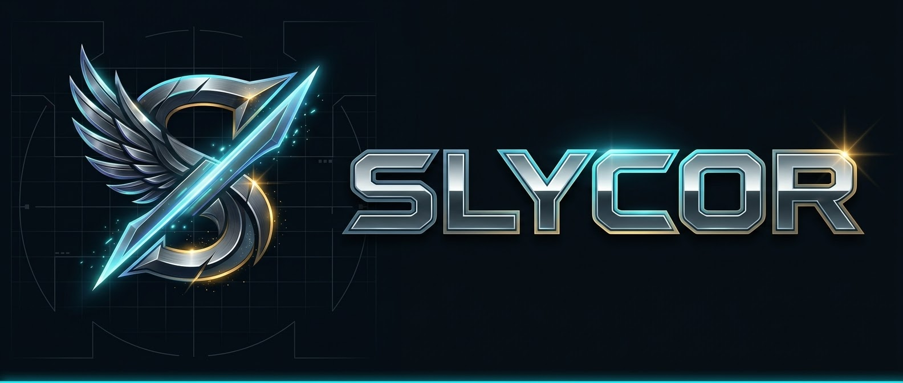
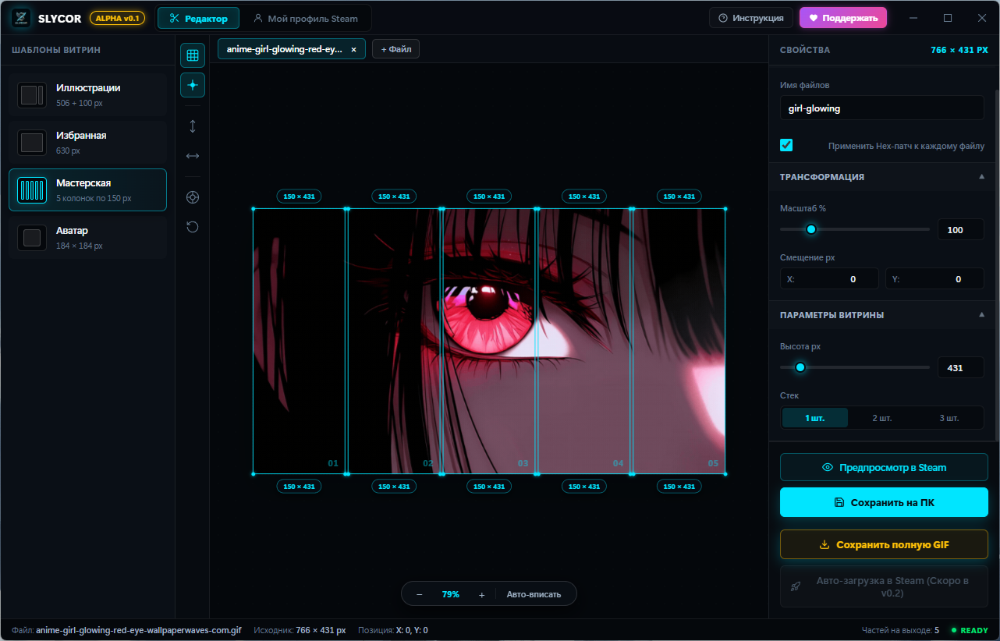
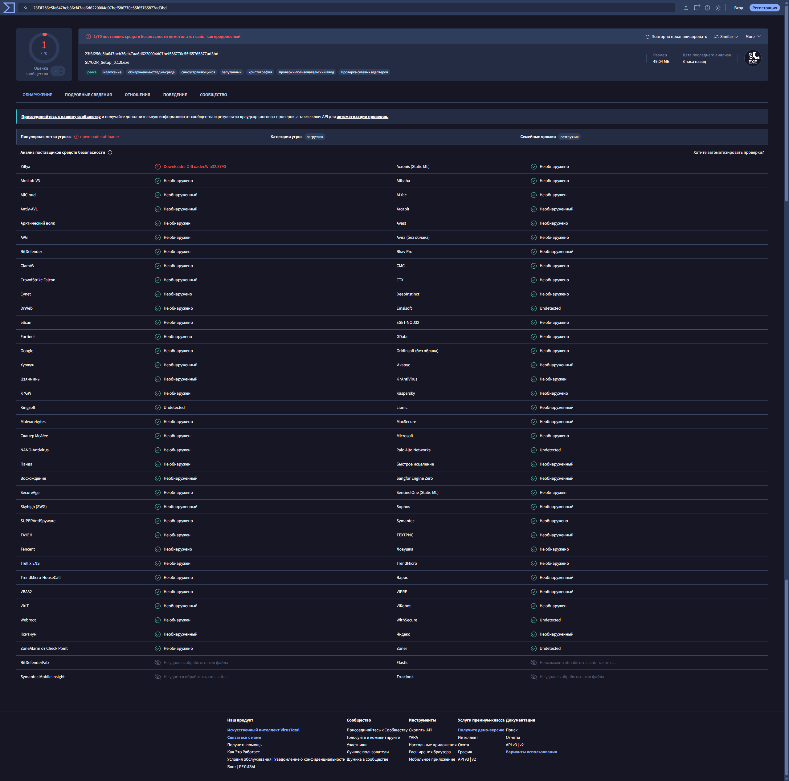

# ⚡ SLYCOR (v0.1.0-alpha)

**Ультимативный десктопный комбайн для нарезки витрин, анимированных артов и оформления профиля Steam 1:1.**  
*The ultimate desktop studio for slicing Steam showcases, animated artworks, and live 1:1 profile preview.*

[-lightgrey?style=for-the-badge)](#license)

### 📥 [СКАЧАТЬ SLYCOR v0.1.0-alpha (Windows x64)](https://github.com/Cornix1999/slycor/releases/latest)

[🇷🇺 Русский](#-описание-и-возможности) • [🇬🇧 English](#-overview--features) • [🛡️ Проверка на вирусы](#️-безопасность-и-virustotal) • [📖 Инструкция](#-как-пользоваться)

---

  

---

## 🇷🇺 Описание и возможности

**SLYCOR** — бесплатная, быстрая и полностью локальная программа для оформления профиля Steam без онлайн-конструкторов, очередей, водяных знаков и передачи ваших данных на сторонние серверы.

### 🔥 Главные фишки v0.1.0-alpha:
* **🎯 4 точных шаблона витрин Steam:**
  * **Иллюстрации (`Artwork`):** `506 + 100 px` с точным зазором `8 px`.
  * **Избранная иллюстрация (`Featured`):** цельный блок `630 px`.
  * **Мастерская (`Workshop`):** нарезка на `5 колонок по 150 px` (зазор `4 px`) + умный алгоритм **«Убрать полосы с картинки»** для уже разрезанных артов.
  * **Аватар (`Avatar`):** `184 × 184 px`.
  * **Стек витрин:** нарезка длинных фонов на **1, 2 или 3 витрины подряд**.
* **🎬 Поддержка видео (`MP4`, `WebM`, `MOV`, `AVI`, `MKV`):** перетащите видеофайл — встроенный движок `FFmpeg` автоматически сконвертирует его в плавный зацикленный GIF.
* **⚡ Многопоточная нарезка и авто-сжатие под 5 МБ:** нативный движок на **Rust + Gifsicle** режет анимацию в несколько потоков и автоматически дожимает вес каждого фрагмента под лимит Steam (`< 5 МБ`) без потери анимации.
* **🧬 Автоматический Hex-патч высоты:** исправляет байты заголовка (`PNG IHDR` и конец файла `GIF 0x3B -> 0x21`) прямо при сохранении, чтобы длинные витрины загружались в Steam на всю высоту.
* **👁️ Живой предпросмотр профиля Steam 1:1:** авторизуйтесь локально через встроенный WebView2, чтобы подгрузить свой реальный фон, аватар, рамку, уровень и примерять витрины прямо на своём профиле.
* **📋 Встроенный помощник загрузки (F12):** программа сама генерирует нужный консольный код под выбранный тип витрины и открывает страницу загрузки Steam в один клик.

---

## 🛡️ Безопасность и VirusTotal

Программа распространяется в виде скомпилированного установщика (`SLYCOR_Setup_0.1.0.exe`). Вся обработка файлов и авторизация происходят **исключительно локально на вашем ПК**.

🔍 **[Проверить SLYCOR_Setup_0.1.0.exe на VirusTotal (Отчёт 1/70 — Undetected у всех ведущих антивирусов)](https://www.virustotal.com/gui/file/23f3f256e5fa647bcb36cf47aa6d6220004d07bef586770c55f65765877ad3bd)**

  

> **⚠️ Примечание по Windows SmartScreen и антивирусам (False Positive):**
> Поскольку это ранняя открытая альфа-версия (`v0.1.0-alpha`) от независимого разработчика без коммерческого сертификата цифровой подписи (*Code Signing*), фильтр **Windows SmartScreen** может показать синее окно защиты при запуске, а 1 малоизвестный антивирус на VirusTotal (`1/70`) реагирует на упаковщик Inno Setup.
> * **Все ведущие антивирусы** (Kaspersky, ESET-NOD32, BitDefender, Avast, DrWeb, Windows Defender и др.) подтверждают, что файл полностью чист (**Undetected**).
> * Чтобы запустить установщик в Windows 10/11, нажмите **«Подробнее» (More info) ➔ «Всё равно запустить» (Run anyway)**.

---

## 📖 Как пользоваться

1. Скачайте **`SLYCOR_Setup_0.1.0.exe`** со страницы [Releases](https://github.com/Cornix1999/slycor/releases/latest) и установите программу.
2. Перетащите картинку (`PNG`, `JPG`, `GIF`, `WebP`) или видео (`MP4`, `WebM`) в окно редактора.
3. Выберите шаблон слева (**Иллюстрации**, **Избранная**, **Мастерская** или **Аватар**) и подгоните масштаб.
4. Нажмите **«Нарезать для Steam»** — в появившемся окне скопируйте готовый консольный код (`F12`) и перейдите на страницу загрузки в Steam.

---

## 🇬🇧 Overview & Features

**SLYCOR** is a fast, free, and 100% local desktop tool for designing and slicing Steam profile showcases (`Artwork`, `Featured Artwork`, `Workshop`, `Avatar`) with a live 1:1 Steam profile mockup.

* **Pixel-Perfect Slicing & Stacking:** Supports 1, 2, or 3 stacked showcases, custom gap adjustment, and automatic stripe removal for pre-sliced Workshop arts.
* **Video to GIF & Multi-threaded Compression:** Built-in `FFmpeg` + `Gifsicle` pipeline converts videos to GIF and automatically optimizes every slice to stay under Steam's **5 MB limit**.
* **Built-in Hex Patcher:** Automatically patches `PNG` and `GIF` headers on export for full-height long showcases.
* **1:1 Live Profile Mockup:** Preview your artwork directly against your actual Steam background, avatar frame, and badges before uploading.

---

## 🗺️ Roadmap & Links

* **Current version:** `v0.1.0-alpha` (Public Alpha)
* **Next (`v0.2`):** Built-in Cyberpunk File Manager, stack reordering, Friends & Groups sidebar blocks, and update notifier.
* **Support & Early Access:** [Boosty](https://boosty.to/cornix)
* **Поддержать проект (без раннего доступа / Donate):** [DonationAlerts](https://www.donationalerts.com/r/cornixen)

---

## 📄 License

**SLYCOR** is distributed as **Freeware (Closed Source)**.  
You are free to download, install, and use the software for personal and commercial Steam profile design. Reverse engineering, decompilation, redistribution of modified binaries, or unauthorized commercial resale of the software itself is prohibited.
